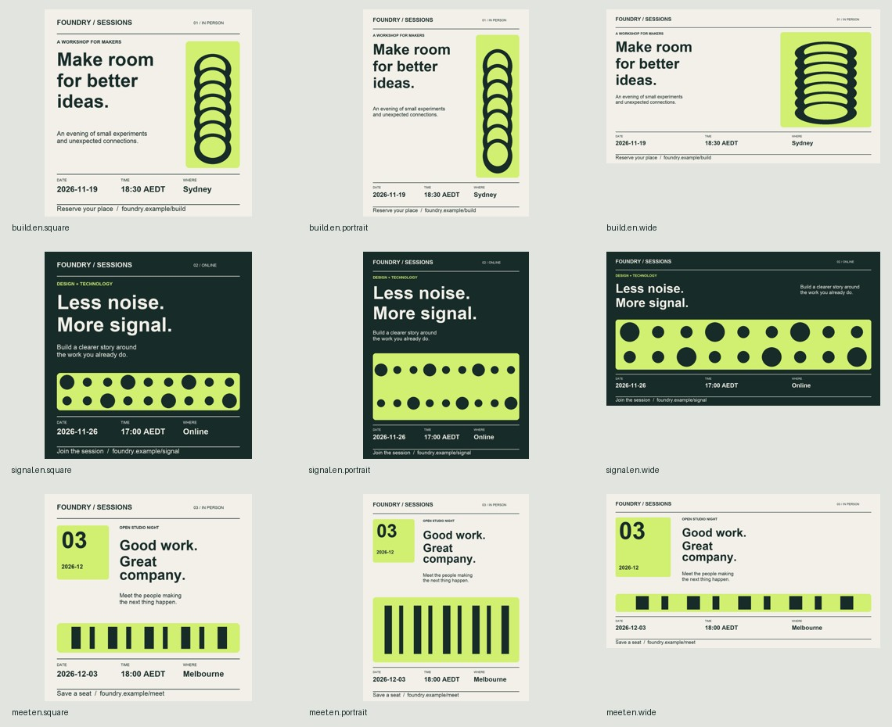

# Material Skills

Local production tools for coding agents. Start with approved information and assets; get editable outputs, a batch manifest, and explicit checks.

**Experimental v0.1.** Three independently runnable skills. No API key or hosted service is required by the builders. Your agent has its own requirements and costs.



| Skill | Give it | Get back |
| --- | --- | --- |
| [Campaign Batch](skills/campaign-batch/SKILL.md) | Brand, approved event copy, optional images | Three layout families × square/portrait/wide; PNG, editable SVG, input JSON, contact sheet, report |
| [Guide Capture](skills/guide-capture/SKILL.md) | Ordered screenshots, actions, observed outcomes | Redacted screenshots, portable HTML/Markdown guide, evidence report |
| [Document Batch](skills/document-batch/SKILL.md) | Quote data, decimal quantities, integer prices | Editable quote HTML, line/subtotal/tax calculations, batch index |

All example brands, events and clients are fictional. Guide screenshots are synthetic fixtures, not a live workflow demonstration.

## Try a demo

Python 3.10+. From the repository root:

```sh
python3 -m venv .venv
.venv/bin/python -m pip install -r requirements.txt
.venv/bin/python skills/campaign-batch/scripts/campaign.py skills/campaign-batch/assets/demo.json --out output/campaign-01
.venv/bin/python skills/guide-capture/scripts/guide.py skills/guide-capture/assets/demo.json --out output/guide-01
.venv/bin/python skills/document-batch/scripts/documents.py skills/document-batch/assets/demo.json --out output/quotes-01
```

On Windows use `.venv\Scripts\python.exe`. Document Batch uses only the standard library; other skills have their own requirements.txt. Open each generated index.html; Campaign also writes contact-sheet.jpg. Use a new output folder for every revision.

No font binaries are bundled. Demo uses Arial on macOS/Windows or DejaVu Sans on Linux. Supply matching licensed font paths for other languages; missing glyphs block that item. SVG text is editable but requires matching installed fonts; PNG is the delivery reference.

## Use with an agent

Copy the desired folder into your agent's supported skill directory. Each contains its own entrypoint, scripts, resources and license. Example from the repository root:

```sh
mkdir -p ~/.agents/skills
cp -R skills/campaign-batch ~/.agents/skills/campaign-batch
```

Use the equivalent directory for your client. Back up existing skill folders before deliberately updating them. Dependencies must be installed in the Python environment the agent runs.

> Use $campaign-batch to make a proof for these approved events. Preserve dates, timezone and registration links. Show the proof before the full batch.

> Use $guide-capture to turn these ordered screenshots into a handover guide. Distinguish supplied evidence from actual observations and redact the marked areas.

> Use $document-batch to prepare these quotes. Recalculate totals, flag disagreements and keep sources editable.

## What the checks mean

- **Campaign:** checks glyphs, text fit/collisions, protected visual regions, dimensions and simple solid-background contrast. Layouts: editorial sidebar, full-width signal and date-first ticket. Not a general graphic designer or platform approval service.
- **Guide:** validates evidence inputs/annotation boxes and bakes redactions into exported pixels. Does not capture workflows, detect private information automatically or verify successful UI actions.
- **Documents:** decimal arithmetic, explicit rounding and supplied-total cross-checks. Quotes only; not invoices, signatures, tax advice or PDF generation.

Technical pass is not an aesthetic score, privacy review or behavioral verification. Inspect final files, especially extremes. No superiority to a strong prompt is claimed yet; see the [evaluation protocol](docs/evaluation.md).

## Feedback

Use the **Use report** issue form to describe a real task, actual result, manual corrections and whether you would use it again. Share sanitized inputs or demo reproductions, never private client data, credentials or unredacted captures.

Issues welcome. Code contributions are not being accepted during the first feedback release; open an issue before investing in a change.

## Development

```sh
.venv/bin/python -m pip install -r requirements-dev.txt
.venv/bin/python -m unittest discover -s tests -v
.venv/bin/python scripts/check_skills.py
.venv/bin/python scripts/package.py --out dist/v0.1.0
.venv/bin/python scripts/smoke_packages.py dist/v0.1.0
```

The archive smoke check runs extracted packages without repository imports, using the current interpreter's installed dependencies. It is not a fresh dependency-install test. See [release status](docs/release-status.md). Builders do not upload user assets or publish files. Browser proof is an optional development check that blocks HTTP requests.

## License

[PolyForm Noncommercial 1.0.0](LICENSE). Each independently distributed skill includes the same license.

## 中文

本地运行的 skill 实验集：活动宣传图、图文操作指南、批量报价单。重点是结构化输入、可编辑交付和可检查的制作过程。示例使用虚构数据；尚未宣称胜过优质 prompt。欢迎通过 Use report 反馈实际完成的任务和人工返工。使用权限以 LICENSE 为准。
